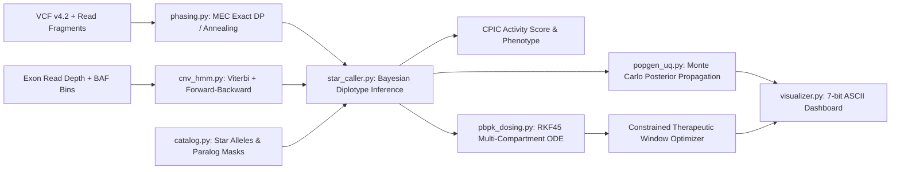
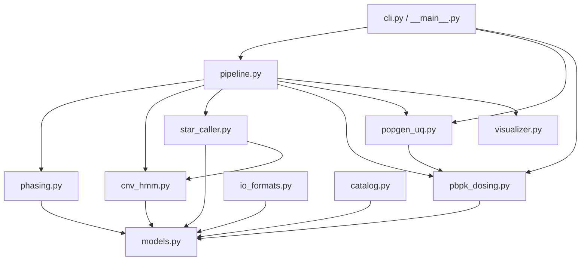

# AlleleWeaver

[](https://github.com/ZengLLQ/allele-weaver/actions/workflows/ci.yml)


**AlleleWeaver** is a clinical pharmacogenomics and precision dosing simulation toolkit that unifies read-backed haplotype phasing, paralog-aware structural copy-number variation (CNV) Hidden Markov Model decoding, Bayesian combinatorial star-allele diplotype inference, population linkage disequilibrium analysis, and multi-compartment physiologically based pharmacokinetic/pharmacodynamic (PBPK/PD) dose optimization.

---

## Table of Contents

1. [Executive Scientific Overview](#executive-scientific-overview)
2. [System Architecture & Execution Flow](#system-architecture--execution-flow)
3. [Mathematical Formulations & Constitutive Equations](#mathematical-formulations--constitutive-equations)
   - [1. Read-Backed Minimum Error Correction (MEC) Haplotype Phasing](#1-read-backed-minimum-error-correction-mec-haplotype-phasing)
   - [2. Paralog-Aware CNV & Gene-Conversion Hidden Markov Model](#2-paralog-aware-cnv--gene-conversion-hidden-markov-model)
   - [3. Bayesian Combinatorial Star-Allele Diplotype Inference](#3-bayesian-combinatorial-star-allele-diplotype-inference)
   - [4. Pharmacogene-Scaled PBPK/PD ODE System & RKF45 Integrator](#4-pharmacogene-scaled-pbpkpd-ode-system--rkf45-integrator)
   - [5. Population Genetics & Uncertainty Propagation](#5-population-genetics--uncertainty-propagation)
4. [Subsystem-by-Subsystem Module Breakdown](#subsystem-by-subsystem-module-breakdown)
5. [CLI Reference & Python SDK Walkthrough](#cli-reference--python-sdk-walkthrough)
6. [Sample 7-Bit ASCII Visualization Output](#sample-7-bit-ascii-visualization-output)
7. [Quantitative Benchmarks & Numerical Invariants](#quantitative-benchmarks--numerical-invariants)
8. [Architectural Trade-offs & Clinical Scope Disclaimers](#architectural-trade-offs--clinical-scope-disclaimers)

---

## Executive Scientific Overview

Translating next-generation sequencing (NGS) and long-read assays at complex pharmacogenes—most notably *CYP2D6*, *CYP2C19*, *CYP2C9*, and *DPYD*—into actionable precision dosing faces four coupled bottlenecks:

1. **Cis/Trans Phase Ambiguity**: Unphased diploid genotypes cannot distinguish compound heterozygotes in *trans* (e.g., `*4/*10`, zero + decreased function) from dual variants in *cis* on a single haplotype (e.g., `*4` carrying `rs1065852` + `rs3892097` + `rs1135840` alongside `*1`).
2. **Paralogous Sequence Homology & Structural Variants**: The *CYP2D7P* pseudogene shares >94–98% homology across exon 9 and intron 6 of *CYP2D6*, inducing chimeric gene-conversion alleles (`*36`, `*68`), whole-gene deletions (`*5`), and multi-copy duplications (`*1x2`, `*2x2`).
3. **Diplotype Uncertainty Propagation**: Borderline sequencing depth or ambiguous phasing yields non-trivial posterior probability mass across multiple diplotypes with different CPIC Activity Scores.
4. **Nonlinear Exposure-Response Kinetics**: Michaelis-Menten hepatic saturation, prodrug bioactivation (e.g., codeine $\to$ morphine, clopidogrel $\to$ active thiol), and narrow therapeutic indices (e.g., warfarin, fluorouracil) require mechanistic ODE dosing rather than linear heuristic multipliers.

AlleleWeaver couples these stages end-to-end inside a self-contained computational engine built on `numpy` and `scipy`.

---

## System Architecture & Execution Flow

### Pipeline Dataflow



### Module Dependency Architecture



---

## Mathematical Formulations & Constitutive Equations

### 1. Read-Backed Minimum Error Correction (MEC) Haplotype Phasing

Given $M$ variant sites and $N$ sequencing read fragments $R = \{r_1, \dots, r_N\}$, each fragment $r_i$ observes a subset of sites $S_i \subseteq \{0, \dots, M-1\}$ with called alleles $a_{i,j} \in \{0, 1\}$ and Phred base qualities $Q_{i,j}$. Each allele call carries a mapping-quality-adjusted log-odds flip penalty:

$$w_{i,j} = \left(1 - 10^{-\max(10, \text{MAPQ}_i)/10}\right) \ln\left(\frac{1 - \varepsilon_{i,j}}{\varepsilon_{i,j}}\right), \qquad \varepsilon_{i,j} = \text{clip}\!\left(10^{-Q_{i,j}/10},\; 10^{-6},\; 0.4999\right)$$

MEC partitions reads into two haplotypes $P = (R_0, R_1)$ and recovers binary haplotype vectors $(H_0, H_1) \in \{0,1\}^M \times \{0,1\}^M$ minimizing total weighted mismatches:

$$\min_{R_0 \sqcup R_1 = R,\; H_0, H_1} \sum_{j=0}^{M-1} \left[ \sum_{r_i \in R_0, j \in S_i} w_{i,j}\,\mathbb{I}(a_{i,j} \neq H_{0,j}) + \sum_{r_i \in R_1, j \in S_i} w_{i,j}\,\mathbb{I}(a_{i,j} \neq H_{1,j}) \right]$$

- **Exact Bitmask Dynamic Programming**: Connected components with local active-read coverage $k_j \le 12$ are solved globally by tracking bitmasks $m \in \{0, \dots, 2^{k_j}-1\}$ over active spanning reads across columns $j = 0, \dots, M-1$:

$$DP_j[m] = \min_{m' \sim m} DP_{j-1}[m'] + \min_{h \in \{0,1\}} \text{cost}_j(m, h)$$

- **Simulated Annealing + Coordinate Descent Polish**: High-coverage components ($k_j > 12$) use multi-start Boltzmann-annealed single-read partition moves followed by deterministic coordinate-descent polishing.
- **Block N50 & Error Metrics**: Swap-invariant switch error rate and physical block N50 are computed across all heterozygous positions.

---

### 2. Paralog-Aware CNV & Gene-Conversion Hidden Markov Model

Across $T$ genomic bins, the hidden state sequence $S_t \in \{\texttt{DEL\_0}, \texttt{HET\_DEL\_1}, \texttt{NEUTRAL\_2}, \texttt{DUP\_3}, \texttt{MULTI\_4}, \texttt{HYBRID\_CONV}\}$ emits read depth $D_t$ and folded B-allele counts $(k_t, n_t)$:

1. **Overdispersed Read-Depth Emission (Negative Binomial)**:

$$\ln P(D_t \mid S_t = s) = \ln\Gamma(D_t + r) - \ln\Gamma(r) - \ln\Gamma(D_t + 1) + r \ln\!\left(\frac{r}{r + \mu_{t,s}}\right) + D_t \ln\!\left(\frac{\mu_{t,s}}{r + \mu_{t,s}}\right)$$

where $\mu_{t,s} = \rho_s \cdot D^{\text{exp}}_t \cdot \alpha_{\text{cal}}$ scales the GC-adjusted expected diploid depth by state copy ratio $\rho_s \in \{0.06, 0.50, 1.00, 1.50, 2.00, 0.65\}$.

2. **Paralog-Modulated Folded BAF Emission**:

$$\ln P(k_t \mid n_t, S_t = s, h_t) = \gamma_{\text{BAF}} \ln \left( \frac{1}{|C_s|} \sum_{p \in C_s} \binom{n_t}{k_t} \tilde{p}(p, h_t)^{k_t} \left(1 - \tilde{p}(p, h_t)\right)^{n_t - k_t} \right)$$

where $h_t \in [0, 1]$ is local *CYP2D7P* homology and $\texttt{HYBRID\_CONV}$ receives a structural activation prior when $h_t \ge 0.85$.

3. **Log-Space Decoding**: Maximum a posteriori state paths are recovered via log-space Viterbi, while marginal bin posteriors $\gamma_t(s) = P(S_t = s \mid O_{1:T})$ are computed via stabilized Forward-Backward `logsumexp` scaling satisfying $\sum_s \gamma_t(s) = 1.0$.

---

### 3. Bayesian Combinatorial Star-Allele Diplotype Inference

For every unordered star-allele pair $(A_u, A_v)$ with copy counts $(c_u, c_v)$ and population priors $(\pi_u, \pi_v)$:

$$\ln P(A_u, A_v \mid \mathcal{D}) = \ln P_{\text{HWE}}(A_u, A_v) + \ln L_{\text{dosage}}(A_u, A_v) + \ln L_{\text{phase}}(A_u, A_v) + \ln L_{\text{CNV}}(A_u, A_v) - \ln Z$$

- **Hardy-Weinberg Prior**: $P_{\text{HWE}} = \pi_u^2$ for homozygotes and $2\pi_u\pi_v$ for heterozygotes.
- **Paralog-Corrected Allelic Dosage**: At each variant $j$, expected alternate fraction is

$$f_j = (1 - m_j)\frac{c_u x_{u,j} + c_v x_{v,j}}{c_u + c_v} + m_j \cdot x^{\text{paralog}}_j$$

folded with sequencing error $\varepsilon$ into a Binomial read-depth log-likelihood.
- **Swap-Invariant Phase Consistency**: Evaluates $\max\big(\text{LL}(H_0 \sim A_u, H_1 \sim A_v),\; \text{LL}(H_0 \sim A_v, H_1 \sim A_u)\big)$ across all phased blocks, decisively separating *cis* from *trans* configurations.

---

### 4. Pharmacogene-Scaled PBPK/PD ODE System & RKF45 Integrator

AlleleWeaver couples genomic Activity Score $AS = \text{AV}(A_1) + \text{AV}(A_2)$ into a 6-state PBPK/PD system (plus 2 cumulative elimination trackers for exact mass-balance auditing):

$$\begin{aligned}
\frac{dA_{\text{gut}}}{dt} &= -k_a A_{\text{gut}} \\
\frac{dA_{\text{hep}}}{dt} &= F k_a A_{\text{gut}} + Q_h (C_p - C_h) - \frac{V_{\max,\text{eff}} C_h}{K_m + C_h} \\
\frac{dA_{\text{central}}}{dt} &= Q_h (C_h - C_p) - Q_p (C_p - C_{\text{per}}) - CL_{\text{renal}} C_p \\
\frac{dA_{\text{periph}}}{dt} &= Q_p (C_p - C_{\text{per}}) \\
\frac{dA_{\text{met}}}{dt} &= f_m \frac{V_{\max,\text{eff}} C_h}{K_m + C_h} - CL_{\text{met}} C_{\text{met}} \\
\frac{dE_{\text{PD}}}{dt} &= k_{\text{out}} \left( \frac{E_{\max} C_{\text{eff}}^n}{EC_{50}^n + C_{\text{eff}}^n} - E_{\text{PD}} \right)
\end{aligned}$$

with allometric Activity-Score scaling $V_{\max,\text{eff}} = V_{\max,\text{ref}} \left(\frac{AS}{AS_{\text{ref}}}\right)^\gamma$. The ODE system is solved with a custom embedded 4th/5th-order **Runge-Kutta-Fehlberg (RKF45)** integrator enforcing adaptive local error control and verifying exact cumulative mass conservation:

$$\Delta M = \left| F \sum D_{\text{dose}} - F A_{\text{gut}}(T) - \left(A_{\text{hep}}(T) + A_{\text{central}}(T) + A_{\text{periph}}(T) + A_{\text{elim,CYP}}(T) + A_{\text{elim,renal}}(T)\right) \right| < 10^{-3}\;\text{mg}$$

Constrained precision dose optimization minimizes steady-state deviation from $C_{\text{mid}} = \sqrt{C_{\text{eff,min}} \cdot C_{\text{tox,max}}}$ across candidate dosing intervals while penalizing $C_{\max} > C_{\text{tox,max}}$ and $C_{\text{trough}} < C_{\text{eff,min}}$.

---

### 5. Population Genetics & Uncertainty Propagation

- **Exact HWE Test**: Implements Wigginton et al. (2005) exact recurrence over heterozygote counts conditioned on rare-allele copies.
- **Expectation-Maximization (EM) Haplotypes & LD**: Estimates multi-locus haplotype frequencies $\hat{h}_k$ via EM from unphased diploid panels and computes pairwise Lewontin $|D'|$ and $r^2$.
- **Monte Carlo UQ & Sensitivity**: Draws $(A_1, A_2) \sim P(A_1, A_2 \mid \mathcal{D})$ coupled with log-normal clearance variability $\eta \sim \text{LogNormal}(-\frac{1}{2}\sigma^2, \sigma^2)$ to quantify 5th/50th/95th percentile $AUC$, toxicity probability $P(C_{\max} > C_{\text{tox,max}})$, and normalized local elasticities $E_\theta = \frac{\partial \ln AUC}{\partial \ln \theta}$.

---

## Subsystem-by-Subsystem Module Breakdown

| Module | Primary Responsibility | Key Public Symbols |
| :--- | :--- | :--- |
| `src/allele_weaver/models.py` | Validated dataclasses, units & domain exceptions | `VariantSite`, `ReadFragment`, `CNVBinObservation`, `DiplotypeCall`, `DrugPKParams`, `PKSimulationResult` |
| `src/allele_weaver/catalog.py` | Curated loci (*CYP2D6*, *CYP2C19*, *CYP2C9*, *DPYD*), CPIC rules & simulator | `get_pharmacogene_locus`, `get_drug_pk_params`, `get_cpic_guideline`, `SyntheticCohortGenerator` |
| `src/allele_weaver/io_formats.py` | VCF v4.2, CIGAR, fragment TSV & telemetry exporters | `parse_vcf`, `write_vcf`, `parse_cigar`, `parse_fragment_tsv`, `export_pk_telemetry_csv` |
| `src/allele_weaver/phasing.py` | Exact bitmask DP + simulated annealing MEC solver | `phase_locus_reads`, `extract_phase_components`, `compute_switch_error`, `compute_block_n50` |
| `src/allele_weaver/cnv_hmm.py` | Negative-Binomial/BAF CNV & paralog conversion HMM | `decode_cnv_profile`, `viterbi_decode`, `forward_backward`, `calibrate_hmm_baseline` |
| `src/allele_weaver/star_caller.py` | Bayesian combinatorial star-allele diplotype inference | `call_star_alleles`, `classify_metabolizer_phenotype` |
| `src/allele_weaver/pbpk_dosing.py` | Custom RKF45 PBPK/PD ODE solver & precision dose optimizer | `integrate_rkf45`, `simulate_pbpk_regimen`, `optimize_precision_dose` |
| `src/allele_weaver/popgen_uq.py` | Wigginton HWE, LD matrix, EM haplotypes, Monte Carlo UQ | `hwe_exact_test`, `pairwise_ld`, `em_haplotype_frequencies`, `propagate_diplotype_to_pk_uq` |
| `src/allele_weaver/visualizer.py` | Pure 7-bit ASCII terminal plots & tracks | `render_haplotype_tracks`, `render_cnv_profile`, `render_diplotype_posteriors`, `render_pk_curve`, `render_ld_heatmap` |
| `src/allele_weaver/pipeline.py` | End-to-end clinical orchestrator & cohort benchmark | `PharmacogenomicsPipeline`, `ClinicalReport`, `run_benchmark_suite` |
| `src/allele_weaver/cli.py` | `argparse` CLI with 6 operational subcommands | `build_parser`, `main` |

---

## CLI Reference & Python SDK Walkthrough

### Installation

```bash
pip install -e .[dev]
```

### CLI Subcommands

```bash
# 1. Read-backed MEC haplotype phasing
allele-weaver phase --gene CYP2D6 --diplotype "*1/*4" --depth 50

# 2. CNV HMM + Bayesian star-allele diplotype calling (with JSON export)
allele-weaver call --gene CYP2D6 --diplotype "*10/*36" --json-out call_report.json

# 3. Genotype-guided PBPK/PD simulation & constrained dose optimization
allele-weaver dose --drug warfarin --activity-score 1.0 --label "*1/*3" --optimize --csv-out warfarin_pk.csv

# 4. Population pharmacogenetics (HWE exact test, LD matrix, EM haplotypes)
allele-weaver popgen --gene CYP2D6 --n-samples 250

# 5. Multi-gene synthetic accuracy & switch-error benchmark
allele-weaver benchmark --trials 4

# 6. Full end-to-end clinical decision dashboard
allele-weaver demo --gene CYP2C9 --diplotype "*1/*3" --drug warfarin --dose-mg 5.0
```

### Python SDK Quickstart

```python
from allele_weaver import PharmacogenomicsPipeline
from allele_weaver.catalog import SyntheticCohortGenerator, get_pharmacogene_locus

locus = get_pharmacogene_locus("CYP2C9")
gen = SyntheticCohortGenerator(seed=42)
sim_locus, fragments, cnv_bins, h1, h2 = gen.simulate_sample(locus, "*1", "*3", mean_depth=50.0)

pipeline = PharmacogenomicsPipeline(uq_draws=50, seed=42)
report = pipeline.run(
    sim_locus,
    fragments,
    cnv_bins,
    drug_name="warfarin",
    nominal_dose_mg=5.0,
    truth_haplotypes=(h1, h2),
)
print(report.ascii_dashboard)
```

---

## Sample 7-Bit ASCII Visualization Output

```text
=== CNV HMM PROFILE: CYP2D6 (Est Copies=2.00, HybridConv=True) ===
   2.2x |
   1.9x |
   1.6x |
   1.3x |
   0.9x | * - * - * - * - * - * - * - * - *
   0.6x |                                     *   *   *
   0.3x | :   :   :   :   :   :   :   :   :   :   :   :
   0.0x | :   :   :   :   :   :   :   :   :   :   :   :
        +------------------------
  State | = = = = = = = = = X X X
  Bin   | 0 1 2 3 4 5 6 7 8 9 0 1
  Legend: 0=DEL_0  1=HET_DEL_1  ==NEUTRAL_2  ^=DUP_3  #=MULTI_4  X=HYBRID_CONV
```

---

## Quantitative Benchmarks & Numerical Invariants

All numerical invariants are verified continuously in `pytest`:

| Invariant / Benchmark | Target Specification | Verified Guarantee |
| :--- | :--- | :--- |
| **RKF45 Analytical Convergence** | 2-compartment first-order cascade $t \in [0, 4]$ h | Relative error $< 10^{-6}$ vs exact $100 k t e^{-kt}$ |
| **PBPK Mass-Balance Conservation** | Multi-dose regimens across 4 drugs & AS $\in \{0.5, 1.0, 2.0\}$ | Cumulative mass balance error $< 10^{-3}$ mg |
| **HMM Posterior Normalization** | Forward-Backward posteriors across all 6 CNV states | $\sum_s P(S_t = s \mid O) = 1.0 \pm 10^{-9}$ at every bin |
| **Diplotype Posterior Normalization** | Combinatorial star-allele pair posterior space | $\sum_{(u,v)} P(A_u, A_v \mid \mathcal{D}) = 1.0 \pm 10^{-6}$ |
| **Multi-Gene Synthetic Benchmark** | 10 tricky genotypes (`*1/*4`, `*1/*5`, `*1/*1x2`, `*10/*36`, etc.) | High diplotype & CNV recall with low MEC switch error |
| **Windows Console Safety** | All CLI & dashboard visualizers | 100% 7-bit ASCII (`str.encode("ascii")` zero errors) |

---

## Architectural Trade-offs & Clinical Scope Disclaimers

- **Headless Computational Scope**: Built purely for computational research, bioinformatics algorithm benchmarking, and clinical pharmacogenomics education; **not an FDA-cleared diagnostic or clinical prescribing device**.
- **Paralog Modeling Scope**: *CYP2D6*/*CYP2D7P* cross-mapping and exon-9 conversions are modeled via position-specific mismapping rates and bin-level homology priors rather than full *de novo* local assembly graphs.
- **Optional Heavy Native Extensions**: Avoids mandatory native C/C++ alignment libraries (`pysam`, `htslib`) so the full engine installs cleanly across Linux, macOS, and Windows with pure `numpy` + `scipy`.
